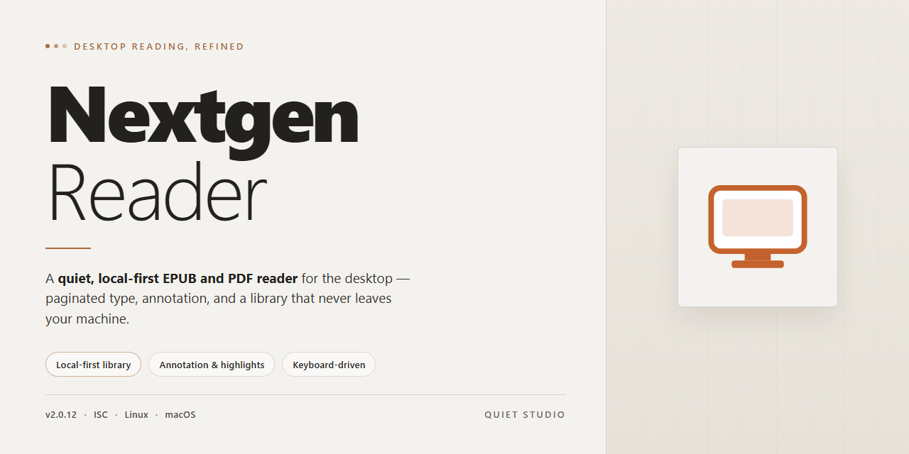

# Nextgen Reader: Feedly-Synced RSS Client for Windows 11

### 🚀 PowerShell Quick Install

     

---

Nextgen Reader is a native Windows RSS client engineered for high-throughput feed aggregation and low-latency content retrieval on the desktop. The application provides bidirectional synchronization with Feedly, enabling feed state, read status, and saved articles to remain consistent across devices without relying on a browser runtime. Its reading pipeline supports offline article caching, customizable feed organization, and a distraction-free interface optimized for sustained consumption of high-volume media streams. Built for Windows 10 and later, Nextgen Reader combines a lightweight footprint with fast rendering and automatic updates to deliver a dependable, feature-complete desktop reading environment.

## ✅ Requirements

- **OS:** Windows 10 / 11
- **Shell:** PowerShell 5.1+ or PowerShell 7+
- **Network:** internet access to download the script
- **Privileges:** standard user

## Features

Nextgen Reader delivers a complete RSS reading environment built natively for Windows, combining Feedly synchronization with a responsive desktop interface designed for high-volume feed consumption.

### Core Functionality

- **Feedly Synchronization** — Authenticate with a Feedly account to pull subscriptions, folders, read states, and saved articles across sessions and devices.
- **Native Windows Application** — Runs as a dedicated desktop client rather than a browser tab, eliminating tab clutter and reducing memory overhead during extended reading sessions.
- **Offline Article Cache** — Downloads feed content locally so articles remain accessible without an active network connection.
- **Multi-Feed Management** — Subscribe to and aggregate an unlimited number of RSS sources, with per-feed refresh and display controls.
- **Optimized Rendering Pipeline** — Feed parsing and article layout are tuned for fast load times, keeping navigation responsive even with large subscription lists.

### Reading Experience

- **Distraction-Free Article View** — Strips extraneous page elements and presents content in a clean, typographically consistent reading pane.
- **Dark Mode** — Full interface and article theming for low-light environments, with automatic switching based on system preferences.
- **Feed Organization** — Folder-based categorization and custom grouping let you structure subscriptions by topic, priority, or source type.
- **Saved and Starred Items** — Bookmark articles for later review, with state synchronized back to the connected Feedly account.
- **Keyboard Navigation** — Shortcut-driven browsing for moving between feeds, articles, and read states without leaving the keyboard.

### Synchronization and Data Handling

- **Two-Way State Sync** — Read/unread markers, saved items, and folder assignments propagate bidirectionally between the desktop client and the Feedly service.
- **Incremental Refresh** — Only changed feeds and articles are fetched on each sync cycle, minimizing bandwidth and update latency.
- **Local State Persistence** — Reading position and preferences are retained across application restarts.

### Customization and Maintenance

- **Configurable Layout Options** — Adjustable pane arrangement, list density, and content display settings to match individual workflows.
- **Preference Profiles** — Persistent settings for refresh intervals, notification behavior, and default article views.
- **Automatic Updates** — The application checks for and applies new builds, ensuring access to the latest feed-parsing fixes and feature additions.
- **Lightweight Resource Footprint** — Engineered to run efficiently alongside other desktop workloads on Windows 8.1 and later.

## How It Works

Nextgen Reader operates as a native Windows feed aggregation client that retrieves, parses, and renders syndicated content from RSS and Atom sources. The application follows a local-first architecture: feed metadata and cached article content are persisted in a local data store, allowing the reading interface to remain responsive independent of network availability.

**Feed ingestion pipeline.** On launch, the application initializes its feed engine and performs an incremental refresh cycle. Each subscribed feed is fetched over HTTPS, parsed from its XML source into a normalized content model, and reconciled against the local store. Previously seen entries are deduplicated by stable identifiers, so only new or updated items are committed. Parsing handles common syndication variants, including RSS 0.9x through 2.0 and Atom 1.0, with fallback sanitization for malformed markup.

**Feedly synchronization layer.** Account-based synchronization is implemented as a bidirectional mapping between the local store and the Feedly service. Authentication is performed through an OAuth-style token exchange, after which the client reconciles remote subscription lists with local ones. Read/unread state, starred items, and category assignments are propagated using incremental sync markers, so only deltas are transmitted rather than full feed contents. Conflicts are resolved by last-write-wins semantics on a per-item basis, ensuring consistent state across devices.

**Content rendering.** Article bodies are rendered in a sandboxed reading view that strips scripts, tracking pixels, and unsafe inline styles before display. The renderer supports adaptive typography, adjustable column width, and a dark theme that respects the system appearance setting. Images are lazily loaded and cached locally to reduce repeat network requests. Users can toggle between summary and full-text extraction modes on a per-feed basis.

**Local caching and offline mode.** The cache layer stores article text, feed icons, and thumbnail assets in a size-bounded local database. A configurable retention policy governs how many entries per feed are kept. When connectivity is unavailable, the feed engine defers refresh operations and the UI serves content exclusively from cache, with pending read-state changes queued for the next successful sync.

**Background refresh scheduling.** Refresh intervals are managed by a lightweight scheduler that respects Windows power state and metered-connection flags. Manual refresh, pull-to-refresh equivalents, and interval-based polling are all routed through the same engine, preventing duplicate concurrent fetches per feed. Network failures are handled with exponential backoff and surfaced as non-blocking status indicators rather than modal errors.

**Feed organization.** Subscriptions are organized into user-defined folders and categories that map directly onto Feedly collections during sync. Ordering, unread counts, and filtering are computed locally from indexed metadata, keeping list navigation instantaneous even with large subscription sets. Search operates against the local index, matching titles, feed names, and cached article text without requiring server round-trips.

**Update mechanism.** Application updates are delivered as signed packages and applied on restart. The update checker validates package signatures before staging, and schema migrations for the local data store run automatically on first launch after an upgrade, preserving existing subscriptions and read states.

## Compatibility

Nextgen Reader is built exclusively for the Windows desktop environment, with Windows 10 and Windows 11 as its primary targets. The application runs as a native desktop package, so no browser, runtime dependency, or supplementary framework is required to launch or operate it.

**Operating System** — Windows 10 (version 1809 or later) and Windows 11 are fully supported. Windows 8.1 remains functional for legacy installations, though newer builds receive feature updates first.

**Hardware Baseline** — A dual-core Intel or AMD processor, 2 GB of RAM, and roughly 100 MB of free disk space are sufficient for standard use. Feed caches and offline article storage scale with the size of your subscription list, so heavier libraries benefit from additional storage headroom.

**Display and Input** — The interface adapts to standard desktop resolutions as well as high-DPI displays. Mouse, keyboard, and touch input are all supported, with keyboard shortcuts available for navigation and feed management.

**Account Integration** — Feedly synchronization requires an active Feedly account and an internet connection for the initial sign-in and subsequent refreshes. Once feeds are cached, previously downloaded articles remain readable in offline mode without network access.

**Data and State** — Reading state, feed organization, and offline content are stored locally on the device, and synchronization reconciles changes with Feedly when connectivity is restored. Multiple devices signed into the same Feedly account stay consistent through this mechanism.

**Network Behavior** — The application communicates only for feed synchronization and content retrieval. It operates correctly behind standard proxy configurations and does not require elevated network permissions.

Nextgen Reader is distributed as a free download for Windows and carries no platform-specific licensing restrictions beyond the Windows target described above.

## FAQ

**Is Nextgen Reader free to use?**

Yes. Nextgen Reader is distributed as a full free version for Windows, with no trial limitations or feature gating. All functionality described in the feature set is available in the free build.

**Does Nextgen Reader require a Feedly account?**

A Feedly account is required for synchronization. Nextgen Reader uses Feedly as its sync backend, so your feed subscriptions, read states, and saved articles are stored in your Feedly account and mirrored across devices. Local feed management without Feedly is not supported in this release.

**Which Windows versions are supported?**

Nextgen Reader is a UWP application targeting Windows 10 and later, with a minimum of Windows 8.1. A 2 GB RAM baseline and roughly 100 MB of free disk space are recommended for smooth operation.

**Does Nextgen Reader work offline?**

Yes. Articles are cached locally, allowing you to read previously synchronized content without an active connection. Read states are reconciled with Feedly once connectivity is restored.

**Can I organize feeds into folders and categories?**

Feed organization is handled through Feedly-compatible folders. You can group publications by topic or priority, and the structure stays consistent between Nextgen Reader and your Feedly account.

**Does the reader support dark mode and custom display settings?**

Yes. A dark theme is available for low-light reading, along with configurable feed layout and article view options for adjusting typography and density to your preference.

**Does Nextgen Reader support push notifications for new articles?**

Push notifications are not currently supported. New content is retrieved during synchronization, which can be triggered manually or on the app's refresh schedule.

**How do I remove the application from my system?**

Uninstall through Windows Settings under Apps, or right-click the application entry and select Uninstall. Local cached articles are removed as part of the uninstall process; your Feedly subscriptions remain intact.

**How are updates delivered?**

Updates are distributed through the standard Windows application update channel. No manual patching is required, and feature and stability improvements are applied automatically.

**Where can I find usage documentation and support?**

Refer to the project's documentation and support channels listed in the repository. Include your Windows build, app version, and a description of the issue when reporting problems.

## Disclaimer

Nextgen Reader is provided as a desktop RSS reader application for Windows. The software is supplied on an "as is" and "as available" basis, without warranties of any kind, whether express, implied, or statutory, including but not limited to warranties of merchantability, fitness for a particular purpose, title, or non-infringement.

Feed synchronization, article retrieval, and offline reading depend on third-party services and network conditions outside the control of Nextgen Reader. Availability, accuracy, and completeness of syndicated content are determined by the respective feed publishers and synchronization providers. Nextgen Reader does not guarantee uninterrupted or error-free operation of these integrations and shall not be held liable for delays, omissions, or changes in third-party content or service behavior.

Users are responsible for the feeds they subscribe to and for compliance with the terms of service of any synchronization provider they connect. Nextgen Reader stores and processes feed data locally to support offline reading and feed organization; users are responsible for safeguarding their own devices, accounts, and credentials.

To the maximum extent permitted by applicable law, Nextgen Reader and its contributors shall not be liable for any direct, indirect, incidental, special, consequential, or exemplary damages arising from the use of or inability to use the software, including but not limited to loss of data, loss of content, or business interruption, even if advised of the possibility of such damages.

Nextgen Reader is intended for lawful use only. Users assume full responsibility for how the software is deployed and for any content accessed through it. No guarantee is made regarding compatibility with future Windows updates, third-party service changes, or hardware configurations beyond those documented in the Compatibility section.

## License

Nextgen Reader is distributed as a freely available desktop application for Windows. The software is provided as a complete, fully featured build with no trial limitations, time restrictions, or locked functionality. All core capabilities — including Feedly synchronization, offline reading, multi-feed management, customizable organization, and dark mode — are accessible without a paid tier or activation step.

The application is licensed for personal and professional use on Windows systems. Redistribution, modification, or repackaging of the Nextgen Reader binary is not permitted without explicit authorization from the project maintainers. The software is provided "as is," without warranty of any kind, express or implied, including but not limited to the warranties of merchantability, fitness for a particular purpose, and noninfringement.

Users are responsible for ensuring that their use of Nextgen Reader complies with applicable local regulations and with the terms of any third-party services integrated into the application. Feature availability and update cadence may vary across releases; the maintainers reserve the right to revise functionality, supported platforms, and distribution terms in future versions.